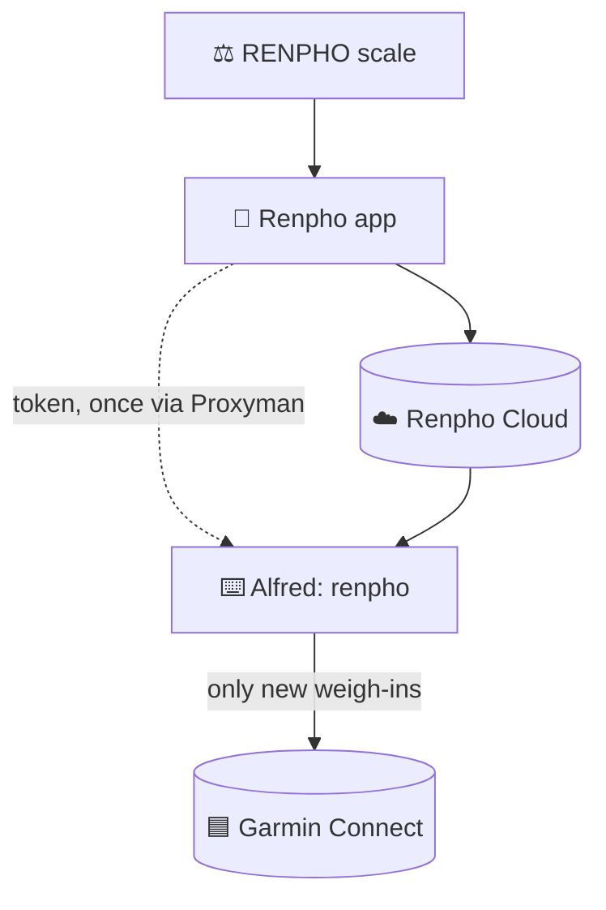
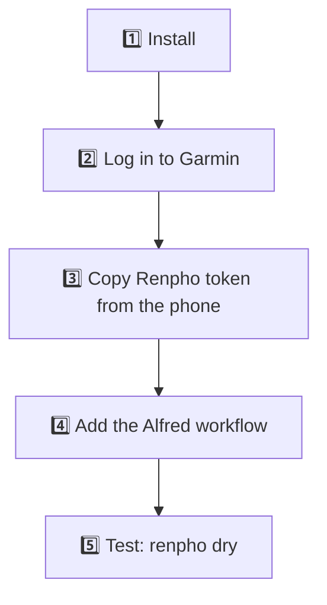
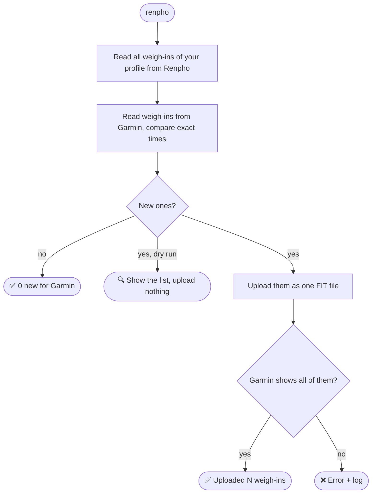
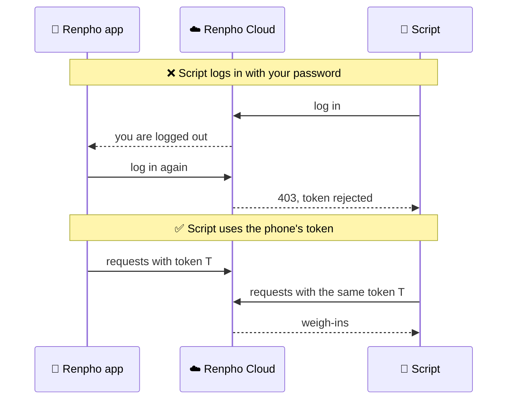

# renpho-to-garmin

Your **RENPHO** scale weigh-ins → **Garmin Connect**, with full body composition (weight, body fat, muscle, bone, water, visceral fat, BMR).

Type `renpho` in Alfred, and every weigh-in Garmin does not have yet is uploaded.



## Setup (once, ~10 minutes)



### Step 1. Install

**Why:** the scripts need a few Python libraries.

```bash
python3 -m venv .venv && .venv/bin/pip install -r requirements.txt
```

### Step 2. Log in to Garmin

**Why:** to upload weigh-ins to your Garmin account.

```bash
.venv/bin/python garmin_login.py
```

Asks for email, password and the MFA code (if Garmin sends one). The password is not saved: only a login token goes to the macOS Keychain.

### Step 3. Copy the Renpho token from your phone

**Why:** to read your weigh-ins from Renpho Cloud. Renpho allows **only one login at a time**, so if the script logged in with your password, your phone app would be logged out. Instead, the script borrows the phone's login.

1. On the iPhone, install [Proxyman](https://proxyman.com/ios), install its certificate and trust it: **Settings → General → About → Certificate Trust Settings**.
2. In Proxyman, turn on **SSL Proxying** for `cloud.renpho.com` and start the VPN.
3. Open the **Renpho** app and pull to refresh.
4. In Proxyman, open a request to `cloud.renpho.com` → **Request → Headers**, copy **`token`** and **`userId`**.
5. Stop the Proxyman VPN.
6. On the Mac, run this and paste both values (the token is hidden while you type):
   ```bash
   .venv/bin/python renpho_import_session.py
   ```
   Then choose your profile (if family members also use the scale).

### Step 4. Add the Alfred workflow

**Why:** one keyword in Alfred instead of a terminal command.

```bash
alfred/build.sh
```

Double-click `dist/Renpho-Garmin-Sync.alfredworkflow` → **Import** → set **Project folder** to this repository folder.

### Step 5. Test

Type `renpho dry` in Alfred. You should see something like:

```
🔍 Renpho → Garmin (dry run)

Renpho: 585 weigh-ins in total, 3 new for Garmin.
```

Nothing is uploaded in a dry run. If it looks right, type `renpho`.

## Daily use

Step on the scale, let the Renpho app sync, then in Alfred:

| Type | What happens |
|---|---|
| `renpho` | Uploads every weigh-in Garmin does not have yet |
| `renpho dry` | Only shows what would be uploaded |
| `renpho 30` | Looks only at the last 30 days (faster) |
| `renpho 30 dry` | Both |

The result appears in big text on the screen until you click. Running it twice is safe: nothing is uploaded twice.

## If something breaks

| You see | Why | Fix |
|---|---|---|
| `Renpho session does not work` | You logged in to the Renpho app again, so the old token stopped working | Repeat [step 3](#step-3-copy-the-renpho-token-from-your-phone) |
| `Saved Garmin tokens do not work` | Garmin login expired | Repeat [step 2](#step-2-log-in-to-garmin) |
| macOS asks to allow Keychain access | Python was updated | Click **Always Allow** |
| `Set 'Project folder'…` | Alfred setting is empty | Set it in the workflow configuration |
| `Unknown input` | Typo in Alfred | Use one of the inputs from [Daily use](#daily-use) |

Full log: `~/Library/Logs/renpho-garmin-sync.log`.

---

## More details

<details>
<summary><b>How one sync run works</b></summary>



The full history is compared every time, so a weigh-in missed earlier is picked up on the next run.

</details>

<details>
<summary><b>Why the Renpho token comes from the phone</b></summary>



The script never asks Renpho for a new token, so the phone keeps working. `renpho_login.py` (email + password) still exists, but it logs the phone out.

</details>

<details>
<summary><b>Where things are stored</b></summary>

| What | Where |
|---|---|
| Garmin login token | Keychain item `renpho-to-garmin.garmin` |
| Renpho token, userId, profile | Keychain item `renpho-to-garmin.renpho` |
| Project folder | Alfred workflow settings |
| Log | `~/Library/Logs/renpho-garmin-sync.log` |

- Tokens are saved with [keyring](https://github.com/jaraco/keyring). See or delete them in **Keychain Access**.
- No passwords are stored anywhere.
- CSV, FIT and JSON files are in `.gitignore`, so your data never goes to git.

</details>

<details>
<summary><b>Command line instead of Alfred</b></summary>

```bash
.venv/bin/python renpho_garmin_sync.py --dry-run   # show what would be uploaded
.venv/bin/python renpho_garmin_sync.py             # upload
.venv/bin/python renpho_garmin_sync.py --days 30   # only the last 30 days
```

After changing files in `alfred/`, run `alfred/build.sh` again and re-import. Python changes need no rebuild.

</details>

<details>
<summary><b>One-time import from a RENPHO CSV export</b></summary>

For old history without Renpho Cloud:

```bash
.venv/bin/python renpho_to_fit.py "RENPHO Health-<name>.csv" -o renpho_weight.fit
.venv/bin/python garmin_upload.py renpho_weight.fit
```

Options: `--since` / `--until YYYY-MM-DD`, `--last-per-day`, `--tz Europe/Berlin`.

List or delete old Garmin weigh-ins (delete asks you to type a confirmation):

```bash
.venv/bin/python garmin_weighins.py list   --start 2023-01-01 --end 2026-12-31
.venv/bin/python garmin_weighins.py delete --start 2023-01-01 --end 2026-12-31 --source MANUAL
```

Weigh-ins from this tool have source `INDEX_SCALE` in Garmin; old Garmin CSV imports have `MANUAL`.

</details>

<details>
<summary><b>Notes and limits</b></summary>

- **Metabolic age** is not sent: Garmin Connect web shows it as milliseconds ([forum report](https://forums.garmin.com/de/apps-und-software/mobile-apps-web/f/garmin-connect-mobile-web/447842/metabolic_age-unit-conversion-issue-in-garmin-connect-website)). `--with-metabolic-age` sends it anyway.
- **Skeletal muscle**: Renpho sends a percentage; Garmin gets `weight × %` in kg.
- **Unofficial APIs**: [python-garminconnect](https://github.com/cyberjunky/python-garminconnect) and [renpho-py](https://github.com/ChocoTonic/renpho-py) may break when the services change.
- **Backup**: keep your RENPHO CSV export. It is the source to rebuild everything.

</details>
